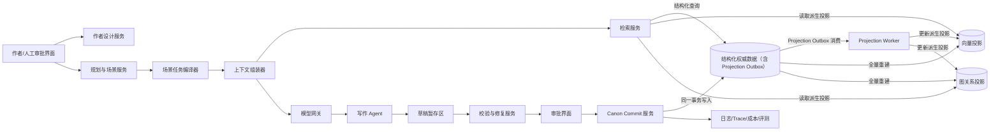

# 系统架构

- 文档编号：DOC-05
- 版本：0.2.7
- 状态：草案
- 更新时间：2026-09-22
- 关联文档：[产品需求](02-product-requirements.md)、[双真实源规范](04-dual-source-of-truth-spec.md)、[上下文组装规范](07-context-assembly-spec.md)、[正式提交协议](08-canon-commit-protocol.md)
- 设计原则：技术中立、模块化优先、先验证核心闭环、避免无依据的复杂中间件
- 工程资产原则：运行时业务数据可以数据库化；代码、数据库迁移、测试集和架构决策必须通过 Git 管理。

## 1. 系统上下文

系统接收作者设计、正文编辑和审批决定，向模型网关发起受控生成/校验调用，并维护作者设计源、Canon 叙事源、草稿暂存区和审计数据。外部模型是受控能力提供方，不是事实源。关系数据库/结构化存储是权威数据源；图关系和向量索引是可重建的检索/查询投影。

## 2. 核心组件与边界

- **作者设计服务**：维护作者设计源及其版本、确认、废弃和影响评估；不把设计直接变成叙事事实。
- **Canon 叙事服务**：提供按快照读取 Canon 叙事陈述、事件和状态的领域接口；写入由正文提交服务受控完成。
- **场景任务编译器**：将设计目标、当前事实、人物视角、秘密权限和写作要求编译为安全场景任务。
- **上下文组装器**：按 `07` 查询、筛选、预算、去重并生成可审计上下文包。
- **模型网关**：统一模型调用、Prompt/模型版本、超时、重试、脱敏和成本记录；不决定事实成立。
- **权限策略与安全投影**：负责 Agent、场景、人物视角、秘密、读者披露状态和日志输出的授权判断；可作为场景任务编译器或领域服务中的模块，不要求新增独立微服务。
- **写作 Agent**：只消费授权场景任务和上下文，输出候选正文、事件和状态变更提案到草稿暂存区。
- **校验与修复服务**：抽取候选事件，执行硬约束校验、软评测和局部修复；不能绕过提交服务。
- **正文提交服务**：执行审批、版本边界检查、幂等、Canon 原子写入、Projection Outbox 写入和审计；Canon 事务成功后由投影任务更新当前状态等派生投影。
- **投影 Outbox/Projection Worker**：Projection Outbox 与 Canon Commit 在同一个事务性结构化数据存储中写入；Projection Worker 从 Outbox 消费任务，幂等地更新图/向量派生投影，并记录处理的 Canon 版本或提交序号。
- **检索服务**：先使用结构化约束和关键词过滤，再按需使用向量/图投影召回；任何召回结果回到权威数据校验。
- **图关系投影**：表达实体关系、事件连接和查询路径，来源为权威数据，可重建，不是事实裁决者。
- **日志/Trace/成本/评测系统**：记录可审计元数据和质量指标，秘密字段按最小暴露原则处理。
- **人工审批界面**：展示候选、证据、冲突、影响和版本，允许批准、拒绝、修改、强制覆盖，但不能隐藏审计。

Agent 不直接操作任意数据表。所有写操作仅通过受限工具或领域服务完成，领域服务根据角色、场景、版本和能力校验输入。

## 3. 主要调用链

### 3.1 生成与校验

1. 作者或规划服务创建 `Scene Task Version`。
2. 工作流服务创建绑定该 Task Version 的 `Workflow Run`。
3. 编译器在 Task Version 绑定的 `Author Design Revision` 和 `Canon Watermark` 一致读取边界上生成安全任务。
4. 上下文组装器执行结构化查询、关键词/向量/图召回、权限过滤、去重和预算编译，冻结只属于该 Task Version 的 `Context Bundle`。
5. 模型网关在该 `Workflow Run` 内创建 `Generation Run`，引用固定 `Context Bundle`；Generation Run 的 Scene Task Version 必须与所属 Workflow Run 完全相同，然后调用写作 Agent，生成属于该 Workflow Run 的 `Candidate Version` 并写入草稿暂存区。
6. 校验服务从 Candidate 抽取 `Narrative Assertion`，形成候选事件/事实/状态提案并执行校验；修复或人工编辑产生新的 Candidate Version，前序 Candidate 默认必须属于同一 Workflow Run，并沿相应修复/人工修改记录追溯直接使用或继承的 Context Bundle，不要求伪造新的 Generation Run。Candidate 的实际 Context Bundle 与所属 Workflow Run 必须具有相同 Scene Task Version。
7. Workflow Run 在多个 Candidate 中最多选择一个当前最终 Candidate；选择、替换或取消均追加不可变选择历史，且只有当前选择与有效且匹配的 Approval Record 同时成立时才可进入审批完成状态。
8. Canon Commit 继续作为独立事务，仅在重新检查当前最终 Candidate、选择历史版本、审批和全部输入绑定后提交 Canon。

### 3.2 正式提交

审批完成后，正文提交服务只能读取 Workflow Run 当前选择的最终 Candidate，先检查选择历史版本、Candidate/Workflow/Context Bundle 的 Scene Task Version 一致性、审批绑定、幂等键和版本冲突，再在一个逻辑事务内写入 Canon 正文、事件、叙事陈述、事实、状态变更、目标/伏笔映射和投影 Outbox；当前状态、图/向量等派生投影由事务成功后的投影任务更新。图/向量任务失败时标记待重试或重建，不回滚已成功的 Canon，详见 `08`。

## 4. 同步与异步边界

场景任务编译、上下文包生成、硬约束校验和审批前的版本检查属于各自受控的同步/异步阶段；Canon Commit 和 Projection Outbox 写入属于独立的同步原子边界。创建或更新 Workflow Run、保存 Generation Run、保存 Candidate/Repair/Human Edit、执行 Validation Run、写入 Approval Record 和执行 Canon Commit 分别使用独立事务或命令边界，不得把完整 Workflow Run 作为覆盖生成、校验、修复、审批和提交的长事务。模型生成、批量抽取、软评测、Outbox 后台投影和统计评测可异步，但异步结果不能伪装为已提交事实，也不能改变已提交事实而不经过修订协议。投影任务必须幂等，并记录所处理的 Canon 版本或提交序号。

当前阶段建议先采用单体应用或模块化服务边界，不引入消息队列；未来若基准测试证明任务隔离、吞吐、失败恢复或索引更新需要改变执行边界，再另行评审。技术选型条件包括数据一致性、可重放性、故障诊断、运维能力和真实容量，而不是组件数量。

## 5. 故障处理原则

- 生成超时：保留任务和调用审计，候选标记失败，可重试但不改变事实。
- 校验服务失败：不得自动放行；任务进入待处理状态。
- 提交事务失败：对外报告未提交，按事务语义回滚或使用可验证的补偿；不允许部分成功状态。
- 索引更新失败：权威 Canon 仍有效，Outbox 记录保留，投影任务进入失败待重试或需要重建；允许从结构化数据重建。查询服务发现投影落后时必须标记降级或结果可能不完整，不能假装与最新 Canon 完全一致。
- 模型/Prompt 版本不可用：使用兼容但不同版本重新执行时，只能标记为“重新运行”或“复现对比”，不得称为与原运行完全相同的确定性重放；完全重放必须绑定原模型、Prompt、工具、上下文包和随机性相关配置，无法满足时标记复现等级和差异原因。
- 权限/秘密疑似泄露：阻断当前任务，记录事件；日志只保留必要脱敏证据，启动影响评估。

## 6. 生命周期状态边界

Workflow Run、Canon Commit、Projection Task 和 Projection Attempt 是不同的状态机，不得用一个状态字段承载全部阶段：

- Canon Commit：准备提交、提交中、已提交、提交失败。
- Workflow Run：创建、生成中、校验中、待修复、待审批、已拒绝、已批准、失败、取消、过期；`approved` 只表示工作流审批完成，不表示 Canon 已提交。
- Projection Task：待处理、已完成、已取消、已放弃、需要重建。
- Projection Attempt：处理中、成功、可重试失败、永久失败、已过期。Canon Commit 后续的反向、撤销、补偿或替代效果通过新的 Canon Commit 和派生关系计算，不改变原 Commit 的已提交状态。

## 7. 未来可扩展点

可在基准测试后扩展：分层归档与冷热事实、更多检索策略、领域专用校验器、多人协作、外部编辑器和发布渠道。扩展不得改变两个叙事业务真实源、草稿非权威、Agent 受限写入和提交原子边界等基础约束。

## 变更记录

| 版本 | 日期 | 状态 | 变更摘要 |
|---|---|---|---|
| 0.2.7 | 2026-09-22 | 草案 | 恢复缺失的 0.2.5 版本历史记录，不改变现行 Workflow Run 创建和投影恢复边界 |
| 0.2.6 | 2026-09-22 | 草案 | 收敛 Workflow Run 创建语义，保留失败重试、任务重调度和投影恢复边界 |
| 0.2.5 | 2026-09-22 | 草案 | 补充 Scene Task 一致性和当前最终 Candidate 的提交前检查；当时出现的 Workflow Run 恢复表述已由 0.2.6 撤回 |
| 0.2.4 | 2026-09-22 | 草案 | 明确 Workflow Run 聚合调用链、Candidate 来源和跨阶段独立事务边界 |
| 0.2.2 | 2026-09-20 | 草案 | 修正 Candidate Version 到候选提案的架构调用链，并将 Canon Commit 生命周期限定为准备、提交中、已提交或失败，同时保留 Outbox 架构 |
| 0.2.1 | 2026-09-20 | 草案 | 统一 Canon Commit 与 Projection Outbox 的事务存储关系，修正快照命名和完全重放/重新运行语义 |
| 0.2.0 | 2026-09-20 | 草案 | 第一轮跨文档一致性修订：补充权限安全投影、Canon 提交 Outbox、幂等投影和三类生命周期状态 |
