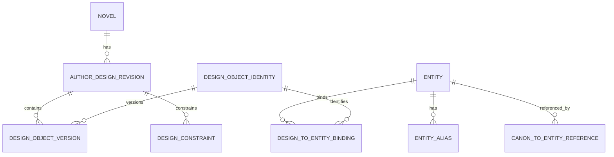
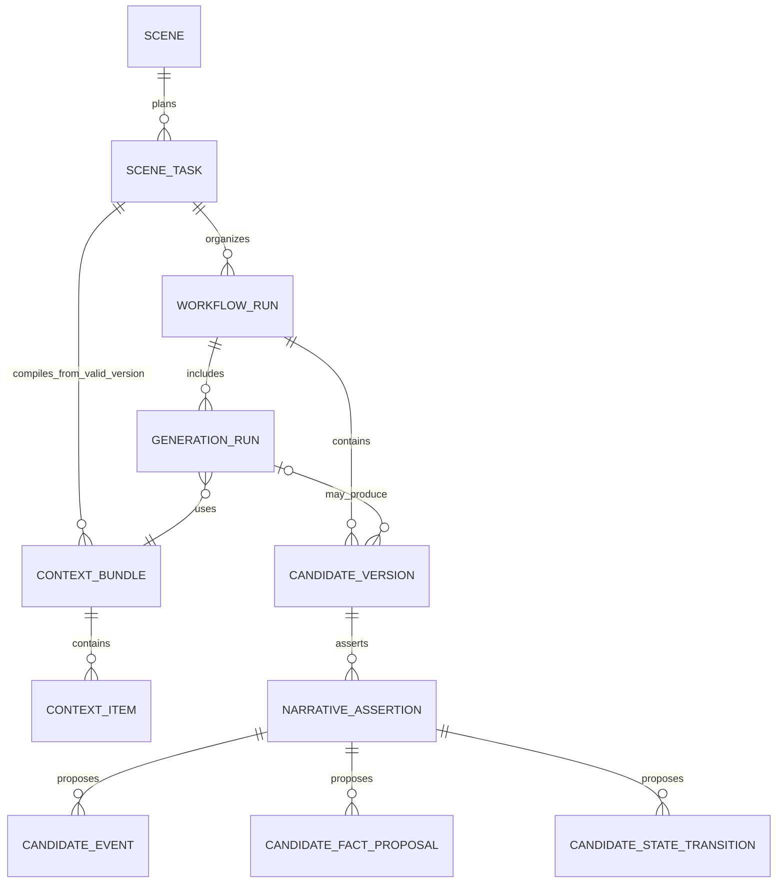
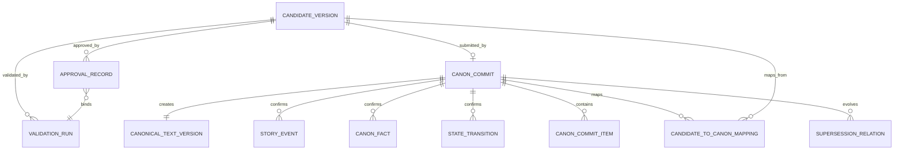
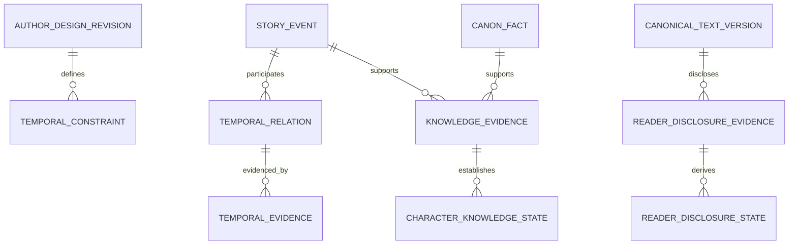
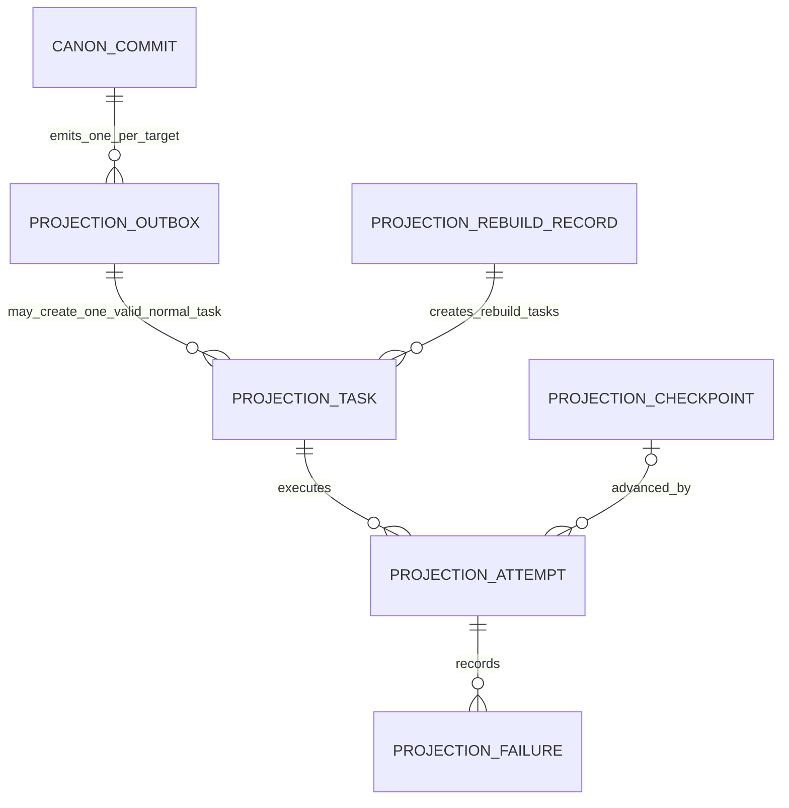

# 数据库逻辑模型

- 文档编号：DOC-09
- 版本：0.1.8
- 状态：草案
- 更新时间：2026-09-22
- 规范性依赖：[产品需求](02-product-requirements.md)、[双真实源规范](04-dual-source-of-truth-spec.md)、[叙事数据模型](06-narrative-data-model.md)、[Canon 正式提交协议](08-canon-commit-protocol.md)
- 参考性引用：[系统架构](05-system-architecture.md)、[上下文组装规范](07-context-assembly-spec.md)

## 1. 文档边界

本文件把现有概念对象映射为数据库逻辑结构，负责逻辑域划分、聚合边界、实体关系、权威性分类、稳定身份与版本、跨域引用、生命周期和总体逻辑决策。它不替代 `06` 对领域对象业务含义的定义，也不替代 `08` 对 Canon Commit 协议的定义。

本文件不设计 SQL DDL、数据库字段类型、索引语法、分区策略、ORM、API、数据库厂商、部署拓扑、消息队列或微服务。文中“记录”“引用”“唯一性”和“事务”均为逻辑语义，物理实现留到后续阶段。

## 2. 总体原则与逻辑域

系统的叙事业务真实源只有两个：Author Design Source 与 Canon Narrative Source。Candidate、审批、校验、提交、Outbox 和审计记录可以是权威运行记录，但不是第三个叙事真实源。结构化数据库中的权威记录是最终依据；图、向量、搜索索引和缓存均为可重建投影。

| 逻辑域 | 主要内容 | 性质 | 逻辑模型边界 |
|---|---|---|---|
| Project Structure | Novel、Volume、Chapter、Scene | 结构权威记录 | 稳定组织身份，不承载候选或 Canon 状态 |
| Cross-domain Identity | Entity、Alias、设计绑定、Canon 引用 | 跨域身份记录 | 连接两个真实源，不承载完整设计或完整事实 |
| Author Design | 设计对象身份、版本、规则、人物、伏笔、秘密、结局约束 | Author Design Source | 表达“应该如何设计” |
| Writing Execution | Scene Task、Workflow Run、Context Bundle、Generation Run、模型/工具/成本/Trace | 执行记录 | 保存受控运行输入、过程和输出引用 |
| Candidate | Candidate Version、Narrative Assertion、候选事件/事实/状态提案 | 非 Canon 候选记录 | 在提交前不可解释为已发生事实 |
| Validation and Approval | Validation Run、Issue、Result、Repair、Approval、Exception | 校验/治理记录 | 约束候选是否可提交，不替代事实源 |
| Canon | Canon Commit、Canonical Text、Story Event、Canon Fact、State Transition、证据 | Canon Narrative Source | 表达已经正式提交的叙事内容 |
| Knowledge and Disclosure | 角色知识/信念、披露证据、读者披露状态、当前状态 | 以 Canon 为依据的记录/派生数据 | 知道、相信、读者已见和客观事实分离 |
| Temporal Relations | Author Design Temporal Constraint、Canon Temporal Relation、同源 Time Interval、同源 Temporal Evidence、派生 Derived Timeline View | 设计约束与 Canon 关系分离；Time Interval/Temporal Evidence 继承 source domain 和来源版本；Derived Timeline View 为派生查询视图 | Derived Timeline View 本身不是独立真实源 |
| Commit and Watermark | Canon Commit、Canon Commit Sequence、Canon Watermark、supersedes/reverses/compensates 关系 | Canon 治理记录 | 表达不可变提交的演进关系 |
| Projection | Projection Outbox、Projection Task、Projection Attempt、Checkpoint、Failure、Rebuild | Outbox 是 Canon 事务内的权威运行记录；Task/Attempt/结果是投影执行记录 | 只能从权威记录更新投影，不能反写权威源 |
| Audit and Observability | 模型调用、Prompt、工具、成本、人工修改、评测 | 审计数据 | 追加为主，按权限脱敏 |
| Authorization and Visibility | Actor、Role、Capability、Scope、Visibility Decision、Access Audit | 治理/安全记录 | 以默认拒绝控制数据和能力边界 |

## 3. 聚合边界

聚合根负责维护其内部不变量；跨聚合引用只使用稳定 ID、不可变版本或水位，不通过共享可变对象隐式同步。

| 聚合根 | 包含或管理的记录 | 同一事务必须保持的关系 | 跨聚合与异步边界 |
|---|---|---|---|
| Project/Novel | Volume、Chapter、Scene 的结构层级 | 父子归属、顺序和归档状态 | 设计、Candidate、Canon 通过 ID 引用 |
| Author Design Revision | Design Object Identity/Version、Constraint、设计对象版本集合 | 草案可编辑；确认/冻结后的内容、对象版本集合、生效范围和依据不可变 | Canon 影响评估可异步，但不得改写旧设计 |
| Scene Task | 任务版本、场景目标、视角、允许/禁止条件 | Task Version 先存在，并绑定 Design Revision 与 Canon Watermark | Context Bundle 只能引用已存在且有效的 Task Version，并由编译器冻结 |
| Workflow Run | 生成、校验、修复、审批的运行关系和状态 | 必须且只能关联一个 Scene Task Version；可包含多个 Generation Run、Validation Run、Repair Record、Approval Record 和 Candidate Version；最多选择一个当前最终 Candidate Version；选择、替换或取消均追加不可变选择历史 | 聚合只原子维护自身状态、Scene Task Version 引用、当前最终 Candidate 引用、选择历史及必要审计；其他执行记录分别由独立事务创建，通过稳定 ID 组织；Canon Commit 为独立聚合和事务边界 |
| Context Bundle | Context Item、Source Reference、裁剪和哈希 | 条目顺序、来源版本、权限结果、内容哈希一致 | 生成过程只读引用，不能原地修改 |
| Generation Run | 模型调用、工具调用、候选输出引用 | 必须且只能属于一个 Workflow Run，并必须且只能绑定一个冻结 Context Bundle；该 Bundle 的 Scene Task Version 必须与 Workflow Run 的 Scene Task Version 完全相同；一次运行可产生零到多个 Candidate Version | 候选抽取和校验可异步 |
| Candidate Version | Candidate 文本、Assertion、候选结构化提案 | 必须且只能属于一个 Workflow Run；必须绑定或明确继承具体 Context Bundle，且该 Bundle 的 Scene Task Version 必须与 Workflow Run 的 Scene Task Version 完全相同；Generation Run 是可选的直接来源；模型生成必须关联 Generation Run，修复/人工编辑必须通过同一 Workflow Run 内的前序 Candidate 与 Repair Record/Human Change Record 追溯；内容变化产生新版本，不原地覆盖 | 不得直接写入 Canon，不得伪造 Generation Run |
| Validation Run | Validation Result、Issue、规则/策略版本 | 校验输入候选哈希和快照一致 | 新输入产生新运行，不覆盖旧结果 |
| Approval Record | 审批决定和绑定输入 | 必须绑定一个明确且唯一的 Candidate Version 身份、该 Candidate 的内容哈希、Context Bundle、Author Design Revision、Canon Watermark、Validation Run 和 Approval Policy Version；Approval 产生时该 Candidate 必须是所属 Workflow Run 的当前最终 Candidate | Approval 只能用于其明确审批的 Candidate Version；即使另一个 Candidate Version 的正文、内容 hash、Context Bundle、Design Revision、Canon Watermark、Validation Run 和 Approval Policy Version 完全相同，也不得继承或复用原 Approval；当前最终 Candidate 被选择、替换或取消后，必须追加 Approval Invalidation Record，不得修改或删除原 Approval；即使重新选择原 Candidate，旧 Approval 也不得恢复，必须重新审批产生新 Approval；Workflow Run 历史 `approved` 状态不得代替当前有效 Approval |
| Canon Commit | 绑定一个 Workflow Run 当前最终 Candidate 的不可变正式提交 | 必须绑定 Workflow Run、该 Workflow Run 当前最终 Candidate Version 的明确身份、Candidate Selection History 当前有效版本、与该 Candidate 身份完全匹配的有效 Approval Record 和 Approval Policy Version；Candidate 必须属于该 Workflow Run，并与其 Scene Task Version 一致 | 提交时重新验证当前选择未被替换、选择版本仍有效、Approval 指向同一 Candidate Version 且全部输入匹配；历史 Candidate 即使曾经审批通过也不得进入 Canon；Canon 记录、严格单调的成功 Commit Sequence、Canon Watermark 和全部 Outbox 原子一致；Derived Current State、Reader Disclosure State、Derived Timeline View、Design Fulfillment State 和投影结果均在事务外更新 |
| Projection Task | 一个逻辑投影工作 | 普通 Task 关联一个 Projection Outbox；重建 Task 关联一个 Projection Rebuild Record；origin 只能二选一 | 一个 Outbox 对零到一个有效普通 Task；重建记录可产生一个或多个明确范围 Task；事务外创建；重试创建 Attempt |
| Projection Attempt | 一次领取、执行、超时、失败或成功尝试 | Attempt 绑定 Task、源水位和策略版本 | 成功且未过期 Attempt 才能推进 Checkpoint，旧 Attempt 不得回退 |

`Entity Merge/Split` 及其审计关系属于跨域身份治理聚合；合并/拆分事务只改变身份映射和未来引用策略，不改写历史正文、事实或设计版本。`Constraint Exception` 属于治理聚合，不属于 Canon 聚合。

## 4. 身份与版本模型

| 对象类别 | 身份/版本模式 | 当前指针与历史规则 |
|---|---|---|
| Entity | 稳定跨域身份；别名和绑定另有记录 | 合并、拆分和失效通过关系记录；历史引用不改写 |
| Chapter、Scene | 稳定结构身份 + 可选内容版本 | 结构身份不随候选或发布版本变化；正文版本另行保存 |
| Author Design Object | 稳定设计对象身份 + 不可变 Design Object Version | 当前生效版本是可重建指针；旧版本保留 |
| Author Design Revision | 草案阶段可编辑；确认/冻结后不可变的项目级设计修订 | 后续变化产生新 Revision，旧 Revision 保留 |
| Candidate Version | 每次候选正文或修复均为新版本 | 内容哈希绑定；候选只能失效、替代或被映射，不能改成 Canon |
| Canonical Text | 稳定文本身份 + 不可变 Canonical Text Version | 发布修订产生新版本，旧版本通过关系保留 |
| Canon Fact、Story Event、State Transition | 每次确认均为不可变 Canon 记录 | 反向、替代、补偿和修订使用新记录及显式关系 |
| State Transition / Derived Current State | State Transition 是权威变化记录；Derived Current State 是派生指针/快照 | 当前结果必须能从有效转换和证据重建 |
| Context Bundle | 冻结版本或完全不可变记录 | 生成和审批只能引用已冻结版本 |
| Prompt/Policy/Validation Rule | 稳定版本身份 + 不可变版本 | 版本变化产生新运行，不覆盖历史输入 |
| Canon Commit Sequence / Canon Watermark | 成功 Canon Commit 的单调序列及其逻辑快照边界，不是独立实体 | 仅成功 Commit 推进；失败或回滚请求不推进；对外水位不得倒退 |

删除优先表达为归档、失效、废弃、撤销或替代。物理清理属于待确认的保留策略，不能破坏可重放所需的历史证据。`supersedes` 表示替代，`reverses` 表示反向效果，`compensates` 表示补偿效果；三者均不修改被指向的历史记录。

## 5. 逻辑关系图

以下图只表达逻辑关系，不表达物理表、字段类型或索引。

### 5.1 Author Design 与 Entity

### 5.2 执行与 Candidate

每个 Workflow Run 可以包含零到多个 Candidate Version，但最多选择一个当前最终 Candidate Version；选择、替换或取消均通过追加式不可变选择历史表达，历史选择不得删除或改写。选择关系不新增独立实体。每个 Generation Run 可以产生零到多个 Candidate Version，一个 Candidate Version 最多关联一个直接来源 Generation Run，非模型 Candidate 可以没有 Generation Run。逻辑一致性必须满足：Workflow Run.Scene Task Version = Generation Run.Context Bundle.Scene Task Version = Candidate Version.Context Bundle.Scene Task Version；该相等关系不要求物理表机械重复字段。Canon Commit 只能提交该 Workflow Run 当前有效选择历史指向的最终 Candidate，并且必须使用明确指向该 Candidate Version 身份、与其内容 hash 及全部当前绑定条件完全匹配的 Approval Record 和 Approval Policy Version；其他 Candidate 即使内容和全部输入相同也不得复用该 Approval。

### 5.3 Canon Commit 与 Canon

### 5.4 知识、披露与时间

`TEMPORAL_RELATION` 属于 Canon Narrative Source；`TEMPORAL_CONSTRAINT` 属于 Author Design Source。图中不建立两者之间的强制父子关系；二者比较只属于跨源校验、冲突检测或映射评估，不表示权威继承、来源合并，也不允许任何一方静默覆盖另一方。`TEMPORAL_EVIDENCE` 必须保留 source domain 和来源版本，不能跨源冒充证据；Temporal Constraint 可以在没有 Canon Temporal Relation 时独立存在。

### 5.5 Outbox 与投影

Projection Task 只组织 Projection Attempt，本身不能直接推进 Checkpoint。一个 Projection Attempt 最多推进一个对应的当前 Checkpoint；同一 Checkpoint 在历史上可以被多个成功 Attempt 逐步推进。失败、过期或未完成 Attempt 不建立推进结果，只有成功且未过期的 Attempt 才能推进 Checkpoint。

## 6. 权威性矩阵

| 关键实体/记录 | 所属性质 | 是否权威记录 | 权威范围 | 是否可变 | 是否可重建 | 来源/写入者 | 可读范围 |
|---|---|---|---|---|---|---|---|
| Author Design Revision | Author Design Source | 是 | 设计意图和约束 | 追加新修订 | 否，旧版本是依据 | 作者/受控设计服务 | 作者、规划、校验、提交；写作仅安全投影 |
| Entity | 跨域身份 | 是权威身份记录 | 稳定对应关系 | 受控治理变化 | Entity 不由投影重建覆盖；可重建的是 Resolution View/当前合并解析结果 | 受控身份服务/作者 | 授权服务和 Agent 的最小身份信息 |
| Candidate Version | Candidate/执行记录 | 是候选内容与执行历史的权威记录；不是 Canon Narrative Source | 候选正文及其哈希，不能解释为已发生事实 | 新版本替代，不原地变 Canon；原始内容必须保留 | 不可依靠重新调用模型精确重建 | 写作/修复服务 | 相关任务、校验、审批和作者 |
| Workflow Run | Writing Execution/Audit | 是权威运行/审计记录，不是第三叙事业务真实源 | 组织生成、校验、修复、审批关系、当前最终 Candidate 和选择历史 | 历史运行追加保留，不覆盖 | 否；Workflow Run 原始运行记录不可由派生投影覆盖或替代，可重建的只是审计查询视图 | 场景/工作流服务 | 作者、校验、审批、审计 |
| Narrative Assertion | 候选或 Canon 证据记录 | 不单独构成事实源 | 必须且只能来源于一个 Candidate Version 或一个 Canonical Text Version；记录来源种类、来源版本、证据范围和确认链 | Candidate 来源不具 Canon 权威；Canon 来源也不自动成为 Canon Fact，只有确认关系才能映射 | 不可由投影替代；确认/否定/替代关系追加 | 抽取/提交服务 | 按候选或 Canon 权限 |
| Validation/Approval | 治理记录 | 是运行/决定记录，不是叙事源 | 校验和审批结果 | 追加失效/新运行 | 可重跑但历史结果保留 | 校验/审批角色 | 作者、校验、提交审计 |
| Canon Commit | Canon 治理记录 | 是提交账本 | 记录一次不可变提交，绑定 Workflow Run 当前最终 Candidate、选择历史版本、有效 Approval 和 Approval Policy Version | 成功不可变 | 不由投影重建 | 提交服务 | 作者、审计、受控服务 |
| Canonical Text、Story Event、Canon Fact、State Transition | Canon Narrative Source | 是 | 已提交正文及确认叙事内容 | 新提交修订，不改历史 | 可由提交链回放 | 仅提交服务 | 授权读者、规划、校验、上下文 |
| Derived Current State、Derived Timeline View、Reader Disclosure State | 派生数据 | 否 | 查询优化后的当前/披露/时间视图 | 可重建替换 | 是 | 投影/查询服务 | 按 Canon Watermark 和视角 |
| Projection Outbox | Canon 投影运行记录 | 是权威运行记录，不是叙事源 | Canon Commit 事务产生的投影意图、源版本、水位和目标 | 原始 Outbox 不可随意删除或重建 | 否；恢复从现存 Projection Outbox 或 Canon Commit 创建 Projection Rebuild Record，再由该记录产生重建 Projection Task/Attempt，不伪造原 Outbox | Canon Commit | 运维、审计、投影服务 |
| Projection Task、Projection Attempt | 投影执行记录 | 是运行记录，不是叙事源 | Task 表示一个 Outbox 目标或 Rebuild Record 范围的逻辑工作；Attempt 表示一次执行尝试 | Task/Attempt 状态受控追加 | Task 可重建执行；Attempt 历史保留 | 投影执行者 | 运维、审计、投影服务 |
| Constraint Exception | 治理记录 | 是授权记录，不是叙事事实 | 约束覆盖依据 | 生效/到期/撤销 | 历史保留 | 作者/授权审批者 | 作者、校验、提交；写作仅安全结果 |
| Design Fulfillment State | 派生数据 | 否 | Design Object 在指定 Canon Watermark 下的实现/满足状态和证据 | 可删除并重算 | 是 | Canon Evidence/投影服务 | 作者、规划、校验；写作只读安全结果 |
| Approval Invalidation Record | 治理记录 | 是审批失效审计 | 记录触发失效的输入变化和原 Approval | 追加 | 否 | 校验/提交服务 | 作者、校验、提交审计 |
| Publication Record | Canon 治理记录 | 是发布运行记录，不是独立叙事事实 | 正式文本版本的发布/撤回/重新发布决定、范围和依据；当前发布状态由 Publication Record 派生 | 新发布/撤回记录，不改正文版本 | 否 | 发布/提交服务 | 作者、审计、影响评估 |
| Impact Assessment、Impact Item | 派生/治理记录 | 否，不是 Canon Narrative Source | 已发布内容修订对后续对象的影响清单 | 可重算，历史评估保留 | 是 | 影响分析服务 | 作者、规划、校验、审计 |

任何实体的读取都必须受 `Data Scope`、角色、人物视角、指定 Canon Watermark 下的 Reader Disclosure State 和秘密安全规则共同约束。写作 Agent 只能接收场景任务编译后的可见投影，不得直接查询任意实体。

## 7. 需求覆盖矩阵

| 需求 | 逻辑域 | 主要实体 | 关键约束 | 覆盖状态 | 待决项 |
|---|---|---|---|---|---|
| FR-001~006 | Project Structure、Author Design、Identity | Novel/Volume/Chapter/Scene、Design Object、Author Design Revision、Entity | 稳定身份、版本、失效、设计源隔离 | 逻辑对象已映射；关键不变量已定义；待物理约束设计；待测试设计 | 具体扩展属性待确认 |
| FR-007~012 | Writing Execution、Authorization | Scene Task、Workflow Run、Context Bundle、Context Item、Scope、Trace | Task Version 先行、Workflow Run 组织运行、冻结 Bundle、来源版本、权限裁剪、哈希可重放 | 逻辑对象已映射；关键不变量已定义；待物理约束设计；待测试设计 | 模型/工具记录粒度待基准确认 |
| FR-013~018 | Candidate、Validation、Approval | Candidate Version、Workflow Run、Narrative Assertion、Proposal、Validation Run、Approval | 候选来源链、最终 Candidate 选择、候选与 Canon 分离、非模型候选不强制 Generation Run、哈希绑定、审批失效 | 逻辑对象已映射；关键不变量已定义；待物理约束设计；待测试设计 | 抽取置信度阈值待基准测试 |
| FR-019~023 | Canon、Commit、Projection | Canon Commit、Canonical Text、Story Event、Fact、Transition、Outbox | 原子提交、幂等、不可变、可重建投影 | 逻辑对象已映射；关键不变量已定义；待物理约束设计；待测试设计 | 多场景冲突检测范围和未来 Commit Group 策略待确认 |
| FR-024~027 | Audit、Governance | Evidence、Trace、Repair、Manual Change、Exception | 来源链、解释、审计和重新校验 | 逻辑对象已映射；关键不变量已定义；待物理约束设计；待测试设计 | 审计保留周期待确认 |
| NFR-001~005 | Canon、Commit、Audit | Evidence、Author Design Revision、Canon Watermark、Commit、Projection | 可追溯、一致、保密、可重放、可恢复 | 逻辑对象已映射；关键不变量已定义；待物理约束设计；待测试设计 | 恢复目标待基准测试 |
| NFR-006~010 | Audit、Execution、Projection | Model/Tool/Cost/Trace、Policy、Projection Task/Attempt | 可观测、可维护、容量和成本记录 | 逻辑对象已映射；关键不变量已定义；待物理约束设计；待测试设计 | 正式阈值待通过基准测试确定 |

## 8. 当前默认与开放项

为遵守 `00` 的开放问题，本模型当前按单一 Canon 主分支、可并行生成但提交需版本检查、未提交草稿不作为事实依据、自动审批关闭、已发布章节修订不自动重写后续章节或下游正文。非线性时间线仅表达相对顺序和时间区间；多个 Canon 分支、草稿依赖仍是待确认项；多场景冲突检测范围和未来 Commit Group 策略待确认。

## 变更记录

| 版本 | 日期 | 状态 | 变更摘要 |
|---|---|---|---|
| 0.1.8 | 2026-09-22 | 草案 | 补全 Approval Record 对特定 Candidate Version 的不可转移绑定，并明确当前最终 Candidate 变化和重新选择后的审批失效规则 |
| 0.1.7 | 2026-09-22 | 草案 | 补全 Canon Commit 对当前最终 Candidate、选择历史和审批策略版本的绑定 |
| 0.1.6 | 2026-09-22 | 草案 | 统一 Scene Task Version 相等关系、选择历史、同工作流前序候选范围并清理实体化表述 |
| 0.1.5 | 2026-09-22 | 草案 | 收口 Workflow Run 聚合事务、Candidate 选择关系和来源链 |
| 0.1.0 | 2026-09-21 | 草案 | 建立从概念对象到数据库逻辑域、聚合、身份/版本、权威性和需求覆盖的首版逻辑模型 |
| 0.1.1 | 2026-09-21 | 草案 | 固定 Canon Commit Sequence/Canon Watermark、提交基数、投影尝试、可重放输入和派生状态边界 |
| 0.1.2 | 2026-09-21 | 草案 | 补充投影普通/重建任务来源互斥、Narrative Assertion 来源和时间证据边界 |
| 0.1.3 | 2026-09-21 | 草案 | 澄清时间关系跨源边界、Reader Disclosure State 绑定和多场景开放项口径 |
| 0.1.4 | 2026-09-21 | 草案 | 补齐 Workflow Run 逻辑模型，修正时间关系图、Checkpoint 推进关系和重建任务来源 |
